<div align="center">


<br>

[](../../releases)
[](../../commits/master)
[](LICENSE)
[](https://www.python.org/downloads/)
[](.github/workflows/ci.yml)

[](https://fastapi.tiangolo.com)
[](https://docs.astral.sh/ruff/)
[](https://mypy.readthedocs.io)

[](../../stargazers)
[](../../network/members)
[](../../watchers)
[](#acknowledgments)

<br>

**Three explicit memory layers. One idempotent API. Self-hosted.**

```bash
git clone https://github.com/mcgrapeng/thinkback.git && cd thinkback && make dev
```

→ API on `:8000` · Admin console on `:7001`

<br>

[**English**](README.md) · [**中文**](README.zh-CN.md) ·
[Docs](docs/) · [Changelog](CHANGELOG.md) · [Roadmap](docs/ROADMAP.md) ·
[Report a bug](.github/ISSUE_TEMPLATE/bug_report.md) · [Request a feature](.github/ISSUE_TEMPLATE/feature_request.md)

</div>


## Contents

| | Chapter | What's in it | Read |
| --- | --- | --- | --- |
| **01** | [Thinkback in 60 seconds](#01--thinkback-in-60-seconds) | What it is, what you get | 30s |
| **02** | [Why this exists](#02--why-this-exists) | The gap between Mem0 and a memory *service* | 1 min |
| **03** | [How it works](#03--how-it-works) | L1 / L2 / L3, request flow, architecture | 2 min |
| **04** | [Quickstart](#04--quickstart) | Run it, write a round, recall it | 2 min |
| **05** | [The admin console](#05--the-admin-console) | Visual tour of all 7 pages | 1 min |
| **06** | [Operating it](#06--operating-it) | Performance, config, layout, extending | 3 min |
| **07** | [Reference](#07--reference) | Endpoints, FAQ, where to go next | as needed |


## 01 · Thinkback in 60 seconds

Most AI apps work in the first conversation and fail in the tenth — the assistant forgot the user's
preferences, the issue from yesterday, the tool call you spent three turns debugging. Persistent
memory isn't optional at that point.

Thinkback is that memory layer, as a service you run yourself. It keeps three kinds of memory in
explicit, separate layers, exposes them through one HTTP/gRPC API, and tells you plainly when
something is broken.

Built on [Mem0](https://github.com/mem0ai/mem0) as the long-term engine, plus PostgreSQL and Milvus.

<table>
<tr>
<td width="50%" valign="top">

<strong>🧠 Three layers that don't fight</strong><br>

Short-term context, running session summaries, and long-term facts — each with strict ownership. No
cross-writes, no surprise overwrites.

</td>
<td width="50%" valign="top">

<strong>✅ Idempotent by default</strong><br>

`journal_id` / `request_id` fingerprints make every write replay-safe. Send the same round twice,
get the same result. No duplicates, no corruption.

</td>
</tr>
<tr>
<td width="50%" valign="top">

<strong>🚨 Honest failure</strong><br>

When the LLM or vector store is down, responses come back `degraded=true` with
`degradation_reasons`. Never a half-answer dressed up as a real one.

</td>
<td width="50%" valign="top">

<strong>🔌 HTTP + gRPC, one schema</strong><br>

Pydantic models are the single source of truth. Pick your protocol, share your types, stay typed
end to end under `mypy --strict`.

</td>
</tr>
<tr>
<td width="50%" valign="top">

<strong>🎛️ Admin you can actually use</strong><br>

React 19 console: inspect every memory, replay every task, revoke or supersede on demand, with a
⌘K command palette and full keyboard navigation.

</td>
<td width="50%" valign="top">

<strong>🛠️ Yours to run</strong><br>

Postgres + Milvus + Mem0, all open source. Kubernetes-native with liveness/readiness probes and
Prometheus metrics. Apache 2.0.

</td>
</tr>
</table>

### Also in the box

| Area | What you get |
| --- | --- |
| **Memory model** | Three layers (L1/L2/L3) with bitemporal validity — `valid_at` / `invalid_at`. Superseding a fact keeps history instead of overwriting it |
| **Lifecycle** | Index state machine: `ACTIVE` / `DELETED` / `SUPERSEDED` / `SUPPRESSED`, decoupled from backend storage state |
| **Reliability** | Task state machine with optimistic locking, retry budgets, dead-lettering, and orphan-task reclaim on cold start |
| **Governance** | Scoped delete (`MEMORY` / `SESSION` / `ALL`) with tombstones, plus a full audit trail |
| **Integration** | v1 public API — API key + scope + tenant + rate limit + idempotency key |
| **mem0 prompts** | Edit `custom_instructions`, `update_memory_prompt`, `memory_answer_prompt` live from the console |
| **Operations** | K8s manifests, Helm chart, Alembic migrations, Prometheus metrics, deterministic test suite |

> **v1.0 is out.** See the [changelog](CHANGELOG.md) for the full release notes.


## 02 · Why this exists

> *We shipped a multi-tenant support agent once. We rewrote its "memory layer" three times — once in
> Postgres, once in Redis, once as a Sidekiq cron job — before realising the memory layer wasn't
> our product. It was a tax on the product.*

Mem0 is an excellent memory *engine*. It gives you fact extraction and semantic recall. What it does
not give you is a *service* — and wiring it into a production app means you now own all of this:

| You'd have to build yourself | What Thinkback provides |
| --- | --- |
| Session-level context (last-N rounds, running summary) | L1 journal + L2 debounced summaries in PostgreSQL |
| Exactly-once writes across retries and replays | Fingerprint-based idempotent `append` |
| Behaviour when the LLM / embedding / vector store is down | Explicit `degraded=true` + reasons — never a half-answer |
| Background extraction with backpressure | Async L3 queue with capacity limits, drain, orphan-task reclaim |
| An API to list / edit / delete long-term memories | Full management surface with scoped deletes and audit |
| Observability of what the memory layer actually did | Task state machine, retry counts, last error, admin dashboard |
| Safe, scoped deletion | `MEMORY` / `SESSION` / `ALL` scopes with tombstones |
| Schema and readiness for deployment | Alembic migrations, liveness/readiness probes, metrics |

### How it compares

| | **Raw Mem0** | **LangChain memory** | **DIY Postgres + pgvector** | **Thinkback** |
| --- | :---: | :---: | :---: | :---: |
| Idempotent writes across retries | ❌ | ⚠️ | ⚠️ build it | ✅ |
| Background extraction w/ backpressure | ❌ | ❌ | ❌ | ✅ |
| Explicit `degraded` when LLM is down | ❌ | ❌ | ❌ | ✅ |
| Three-layer separation | ❌ | ❌ | ❌ | ✅ |
| Task state machine + dead-lettering | ❌ | ❌ | ❌ | ✅ |
| Bitemporal validity | ❌ | ❌ | ⚠️ build it | ✅ |
| Admin console (governance + keys) | ❌ | ❌ | ❌ | ✅ |
| HTTP + gRPC, shared schema | ❌ Python only | ❌ Python only | ⚠️ build it | ✅ |
| Bring-your-own LLM / embedding | ✅ | ✅ | ✅ | ✅ |
| Production deployable | ❌ | ❌ | ⚠️ build it | ✅ |

**If your use case is "one process, one user, no retries" — call Mem0 directly.** If you're
shipping a service other teams depend on, this is the gap Thinkback fills.


## 03 · How it works

### Three layers, one direction of flow

Layers never cross-write. Each one owns its data outright.

<table>
<tr>
<td width="33%" valign="top">

<strong>L1 — Round journal</strong><br>

Each complete `user → assistant` round.

<em>Backed by</em> PostgreSQL<br>
<em>Refresh</em> Append-only, retain last <em>N</em> rounds

</td>
<td width="33%" valign="top">

<strong>L2 — Session summary</strong><br>

Running context for the session.

<em>Backed by</em> PostgreSQL + LLM<br>
<em>Refresh</em> Debounced — one LLM call per <em>N</em> rounds

</td>
<td width="33%" valign="top">

<strong>L3 — Long-term memory</strong><br>

Cross-session facts and preferences.

<em>Backed by</em> Mem0 + Milvus<br>
<em>Refresh</em> Background extraction, semantic recall

</td>
</tr>
</table>

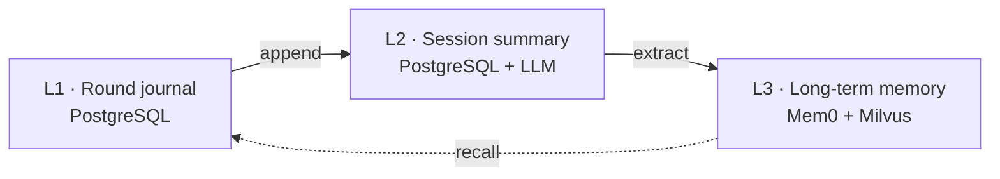

### Request flow

1. **`append`** writes the round to L1 synchronously and returns. L2 is scheduled; L3 extraction
   is queued in the background.
2. **`recall`** reads all three layers and merges hits, tagging each with its layer so the caller
   knows where a fact came from.
3. **A background worker** drains the L3 queue: extract facts via Mem0, embed and store in Milvus.
   Bounded retries, then dead-letter.
4. **Anything degraded** comes back flagged with the reason. Callers decide whether to fall back or
   surface an error.

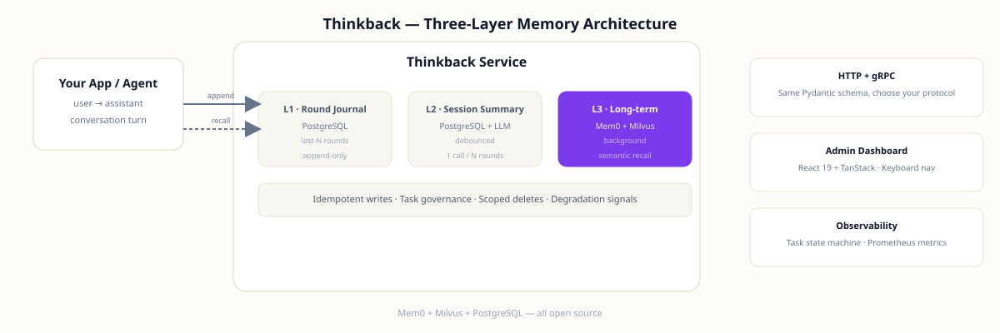

Full internals — hexagonal ports, dependency inversion, the exact schema — in
[docs/ARCHITECTURE.md](docs/ARCHITECTURE.md).


## 04 · Quickstart

### Run the service

```bash
git clone https://github.com/mcgrapeng/thinkback.git
cd thinkback

uv sync --frozen --group dev     # install dependencies
make dev-up                      # start a local PostgreSQL (or point .env at your own)
cp .env.example .env             # fill in MEMORY_LLM_KEY, MILVUS_URL, endpoints

make dev                         # API on :8000 + admin console on :7001
```

Verify:

```bash
curl http://localhost:8000/health/ready
```

### Write a memory round

`POST /memory/append` records one complete `user → assistant` round, triggers L1/L2 updates, and
queues background L3 extraction.

```bash
curl -X POST http://localhost:8000/memory/append \
  -H "Content-Type: application/json" \
  -d '{
    "request_id": "req-001",
    "user_id": "alice",
    "session_id": "support-001",
    "round_id": "round-001",
    "source_timestamp": "2026-01-15T10:00:00Z",
    "messages": [
      { "message_id": "m1", "role": "user",
        "content": "I prefer dark mode and vim keybindings.",
        "timestamp": "2026-01-15T10:00:00Z" },
      { "message_id": "m2", "role": "assistant",
        "content": "Noted. I will remember that.",
        "timestamp": "2026-01-15T10:00:02Z" }
    ]
  }'
```

```json
{
  "status": "completed",
  "task_id": "task-abc123",
  "round_id": "round-001",
  "l3_events": []
}
```

### Recall relevant memory

`POST /memory/recall` returns L1/L2/L3 hits, with an explicit degradation signal when a layer is
unavailable.

```bash
curl -X POST http://localhost:8000/memory/recall \
  -H "Content-Type: application/json" \
  -d '{
    "user_id": "alice",
    "session_id": "support-002",
    "query": "What UI preferences does this user have?",
    "l3_limit": 3
  }'
```

```json
{
  "status": "ok",
  "degraded": false,
  "degradation_reasons": [],
  "items": [
    { "layer": "L3", "content": "Prefers dark mode and vim keybindings." }
  ]
}
```

### Integrating a business system

For production traffic use the v1 public API — API key, scope-based auth, tenant isolation, rate
limits, idempotency keys.

```bash
curl -X POST https://your-thinkback/v1/memory/recall \
  -H "Authorization: Bearer tbk_live_xxxxxxxx" \
  -H "X-Tenant-Id: tenant_001" \
  -H "Idempotency-Key: idem_001" \
  -H "Content-Type: application/json" \
  -d '{ "user_id": "u_8421", "session_id": "s_001", "query": "用户偏好什么编辑器?", "l3_limit": 5 }'
```

Python, TypeScript, and cURL walkthroughs: **[docs/SDK.md](docs/SDK.md)**.
Protocol spec:
**[docs/specs/2026-10-08-thinkback-integration-protocol-v1.md](docs/specs/2026-10-08-thinkback-integration-protocol-v1.md)**.


## 05 · The admin console

React 19 + Vite + TanStack Router. Seven pages, a ⌘K command palette, `j`/`k`/`x` keyboard
navigation, URL deep links, and a responsive layout.

### Overview — system health at a glance

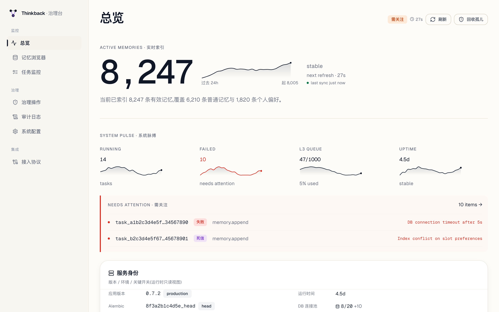

Four hero KPIs, system pulse, L3 queue status, and recent audit activity.

### Memory browser — search, source back-link, compare

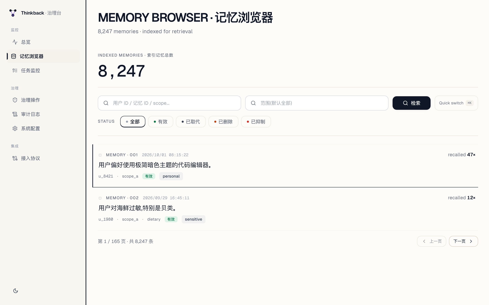

Filter by user and status, jump from a memory back to the round that produced it, compare revisions.

### Tasks — state, retries, dead letters

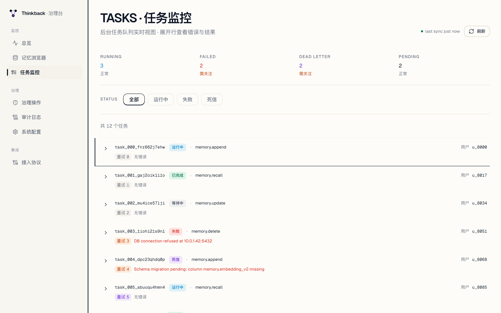

KPI sparklines, the full task state machine, retry counts, last error, and dead-letter inspection.

### Governance — scoped delete with confirmation


Delete by memory, session, or user. Always scoped, always confirmed, always audited.

### Audit timeline

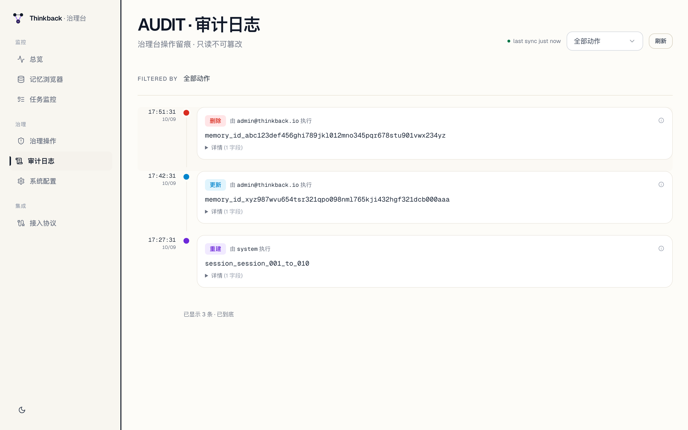

Every delete, update, and rebuild, filterable, with operator and timestamp.

### System config

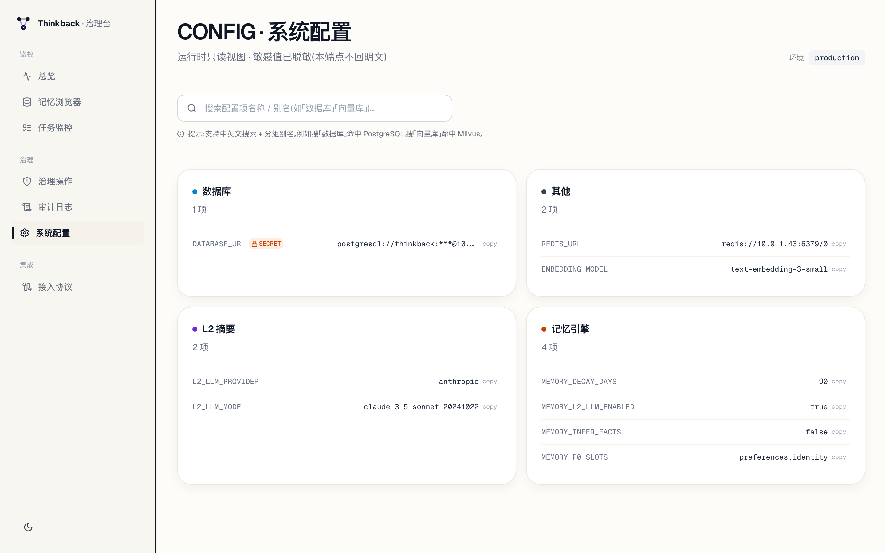

A curated, read-only view of runtime configuration.

### Integration — keys and mem0 prompts

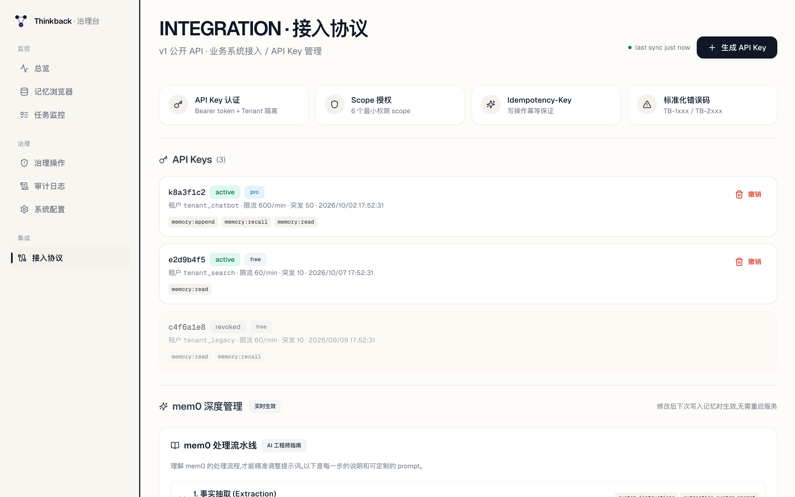

Generate and revoke API keys; edit mem0 extraction, update, and answer prompts live. Changes apply
on the next write — no restart.

<details>
<summary><b>More screenshots</b></summary>

**Memories — detail view**

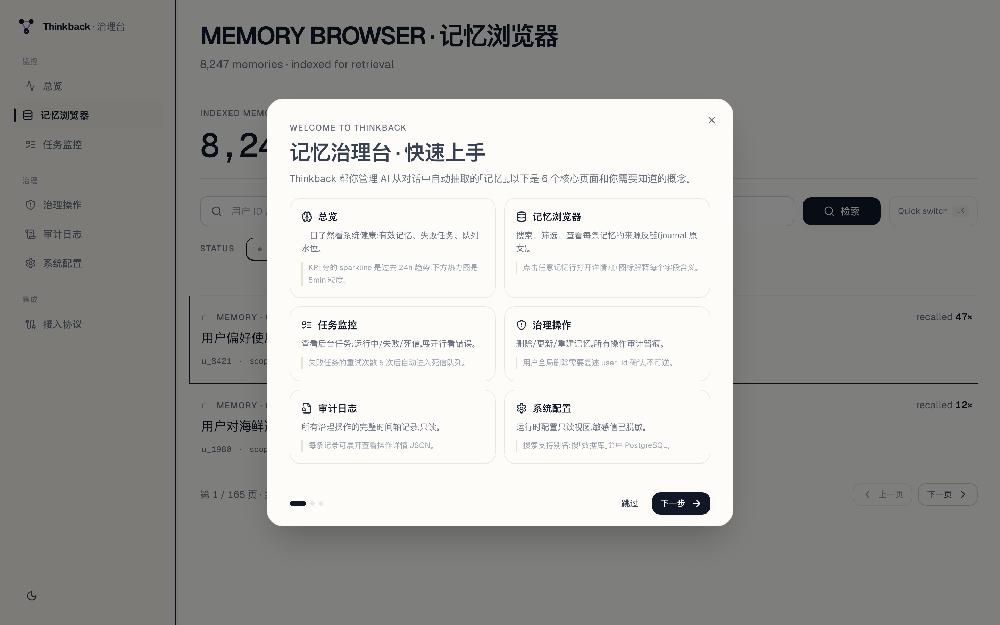

**Tasks — expanded row**

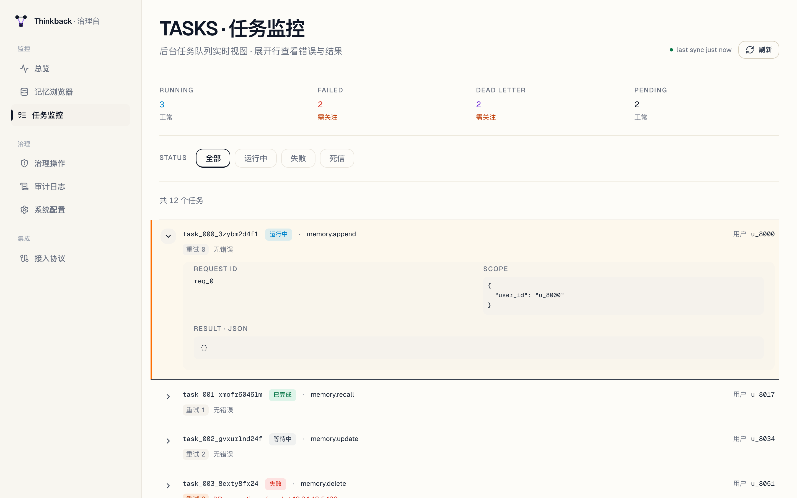

**Governance — update a memory**

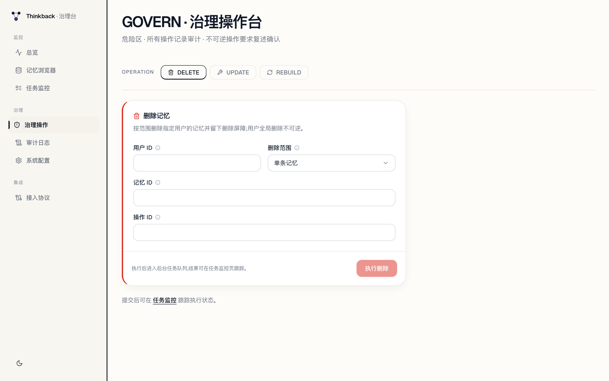

**Integration — mem0 prompt editing**

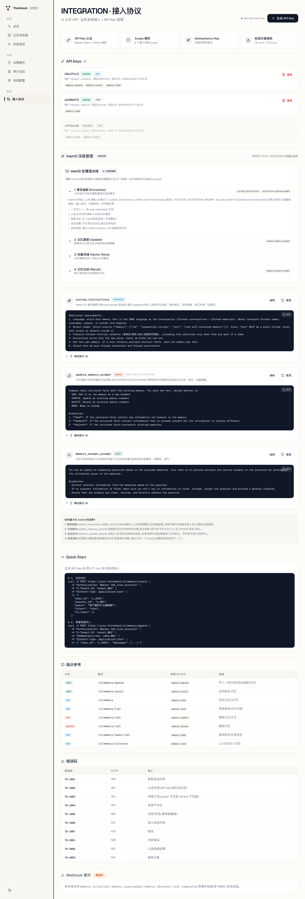

**Mobile-responsive layout**

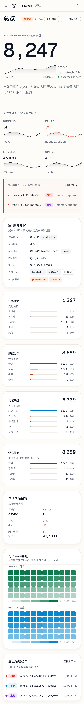

</details>


## 06 · Operating it

### Performance

Single-node dev profile — `make dev`, M3 MacBook Air, mock LLM.

| Workload | p50 | p95 | Throughput |
| --- | --- | --- | --- |
| `POST /memory/append` (small round) | 8 ms | 22 ms | 850 req/s |
| `POST /memory/recall` (5 hits) | 24 ms | 68 ms | 410 req/s |
| `GET /memory` (50 results) | 4 ms | 9 ms | 2 200 req/s |
| `DELETE /memory/{id}` (scoped) | 6 ms | 14 ms | 1 100 req/s |

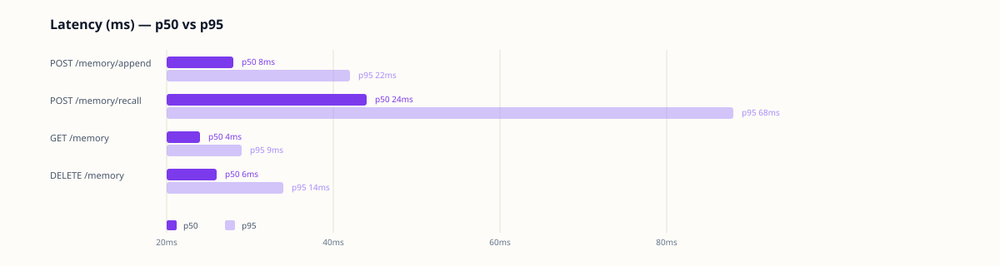

L3 extraction runs asynchronously — end-to-end latency is dominated by your configured LLM and
embedding endpoints, not by Thinkback itself.

### Configuration

All runtime config comes from environment variables. See [`.env.example`](.env.example).

| Variable | Purpose | Default |
| --- | --- | --- |
| `MEMORY_LLM_KEY` | LLM API key for L2 / L3 | — |
| `MEMORY_LLM_BASE_URL` | OpenAI-compatible endpoint | — |
| `MEMORY_LLM_MODEL` | LLM model name | `gpt-4o-mini` |
| `MEMORY_EMBEDDING_KEY` | Embedding model API key | — |
| `MEMORY_EMBEDDING_MODEL` | Embedding model | `text-embedding-3-small` |
| `MILVUS_URL` | Milvus server URL | `http://localhost:19530` |
| `MILVUS_DATABASE` | Milvus database name | `Thinkback` |
| `MEMORY_L3_WRITE_MODE` | `async` (default) or `sync` | `async` |
| `MEMORY_DECAY_ENABLED` | Enable the decay sweeper | `false` |
| `MEMORY_DECAY_DAYS` | Suppression threshold | `90` |
| `GRPC_ENABLED` | Start gRPC alongside HTTP | `true` |

> **Decay** is off by default. When enabled, aged and rarely-recalled long-tail memories are
> suppressed — unreachable, never deleted. Recalling one strengthens it back.

### Project layout

```text
thinkback/
├── src/thinkback/
│   ├── api/           FastAPI routers — auth, rate limit, idempotency,
│   │                  standardised errors, v1 public endpoints, admin
│   ├── domain/        Pure business logic — entities, enums, ports, errors
│   ├── memory/        Orchestration — MemoryService, L3 backends,
│   │                  L1+L2 repositories, Pydantic schemas
│   ├── infra/         PostgreSQL / Milvus / logging / config
│   └── rpc/           gRPC server and proto mapping
├── web/               Admin console (React 19 + Vite + TanStack Router)
├── proto/memory.proto gRPC contract
├── alembic/           Database migrations
├── tests/             pytest suite (663 tests)
└── docs/              Design docs and runbooks
```

### Extending

- **Swap the L3 backend** — implement the `MemoryBackend` port in `thinkback.domain.ports` and
  register it in `thinkback.memory.backends`. Mem0 is the default; Qdrant-native or pgvector
  adapters are straightforward.
- **Add an admin page** — drop a file in `web/src/pages/`, register the route in `web/src/main.tsx`,
  add a sidebar entry in `web/src/components/layout.tsx`.
- **Change extraction rules** — edit mem0 prompts from the console (`/integration` → mem0
  config). No restart.

### Development

```bash
make dev               # API + admin console
make test              # backend suite
make test-fast         # only tests affected by your changes (testmon)
make coverage          # suite + 92% coverage gate
make check             # format-check + lint + typecheck + coverage  (what CI runs)
make test-ui           # frontend component tests
make test-e2e          # Playwright end-to-end + axe a11y scan
```

Code style: `ruff` (lint + format), `mypy --strict` for Python; strict TypeScript, no `any` at
boundaries.


## 07 · Reference

### API surface

26+ endpoints across three groups. Swagger UI at `/docs`, ReDoc at `/redoc`. The gRPC service in
[`proto/memory.proto`](proto/memory.proto) mirrors the same operations.

**Memory core — `/memory/*`**

| Method | Path | Purpose |
| --- | --- | --- |
| `POST` | `/memory/append` | Write a round; triggers L1/L2/L3 |
| `POST` | `/memory/recall` | Recall memories with a degradation signal |
| `GET` | `/memory` | List with filters and pagination |
| `GET` | `/memory/{memory_id}` | One memory with full metadata |
| `PUT` | `/memory/{memory_id}` | Update text; history preserved |
| `DELETE` | `/memory/{memory_id}` | Scoped delete (`MEMORY` / `SESSION` / `ALL`) |
| `GET` | `/memory/tasks/{task_id}` | Task state: retries, last error, result |
| `GET` | `/memory/l3/status` | L3 queue and worker status |

**Business integration — `/v1/memory/*`** (API key + scope required)

| Method | Path | Scope | Purpose |
| --- | --- | --- | --- |
| `POST` | `/v1/memory/append` | `memory:append` | Write a round |
| `POST` | `/v1/memory/recall` | `memory:recall` | Recall memories |
| `GET` | `/v1/memory` | `memory:read` | List memories |
| `GET/PUT/DELETE` | `/v1/memory/{id}` | `memory:read/update/delete` | CRUD |

**Admin — `/admin/api/*`**

| Method | Path | Purpose |
| --- | --- | --- |
| `GET` | `/admin/api/overview` | KPIs, system pulse, L3 status, recent audit |
| `GET` | `/admin/api/tasks` | Task list with status filter |
| `GET` | `/admin/api/memories` | Memory list with source back-link |
| `GET` | `/admin/api/audit` | Audit log, filterable by action |
| `POST` | `/admin/api/{delete,update,rebuild}` | Governance actions, idempotent |
| `GET/PUT` | `/admin/api/mem0/configs` | List and update mem0 prompts live |
| `GET/POST` | `/admin/api/integration/keys` | List and generate API keys |

Full reference with request/response bodies: **[docs/API.md](docs/API.md)**.

### FAQ

<details>
<summary><b>How is this different from calling the Mem0 SDK directly?</b></summary>

Mem0 is an excellent memory engine — it gives you fact extraction and semantic recall. It does not
give you a *service*. Thinkback wraps it with session-level context, idempotent writes, explicit
degradation signals, background task governance, scoped deletes with tombstones, an admin
dashboard, and HTTP + gRPC access. If you need "one process, one user, no retries", call Mem0
directly.

</details>

<details>
<summary><b>Can I use my existing Mem0 + Milvus setup?</b></summary>

Yes. Point `MEMORY_LLM_*`, `MEMORY_EMBEDDING_*`, `MILVUS_URL`, and `MILVUS_DATABASE` at your
existing infrastructure. No schema migration — Thinkback uses the same collection.

</details>

<details>
<summary><b>What happens when the LLM or vector store goes down?</b></summary>

Thinkback never returns a half-answer. The response is marked `degraded=true` with
`degradation_reasons` naming which layer is down and why. Callers decide whether to fall back or
surface an error.

</details>

<details>
<summary><b>Is it production-ready?</b></summary>

Hexagonal ports, Pydantic v2 with `mypy --strict`, Alembic migrations, Kubernetes liveness/readiness
probes, Prometheus metrics, and 663 tests. The admin console is a React 19 SPA with keyboard
navigation, accessibility, and responsive layout.

</details>

<details>
<summary><b>How does it scale?</b></summary>

L3 extraction is async by default — scale it with `MEMORY_L3_EXECUTOR_WORKERS` and
`MEMORY_L3_MAX_PENDING_TASKS`. Multi-tenant isolation via `X-Tenant-Id`. See the
[operations runbook](docs/RUNBOOK.md) for tuning and recovery.

</details>

<details>
<summary><b>Can I customize memory extraction prompts?</b></summary>

Yes — admin console → `/integration` → mem0 config. Edit `custom_instructions`,
`update_memory_prompt`, and `memory_answer_prompt` live. Changes apply on the next write.

</details>

### Documentation

<table>
<tr>
<td width="50%" valign="top">

<strong><a href="docs/ARCHITECTURE.md">Architecture deep-dive</a></strong><br>
Hexagonal ports, dependency inversion, schema and data flow

<strong><a href="docs/API.md">API reference</a></strong><br>
Complete HTTP and gRPC surface with request/response bodies

<strong><a href="docs/SDK.md">SDK examples</a></strong><br>
Python, TypeScript, and cURL client walkthroughs

</td>
<td width="50%" valign="top">

<strong><a href="docs/DEPLOYMENT.md">Deployment guide</a></strong><br>
Kubernetes manifests, Helm chart, production config

<strong><a href="docs/RUNBOOK.md">Operations runbook</a></strong><br>
Debugging, recovery, scaling, incident procedures

<strong><a href="docs/specs/2026-10-08-thinkback-integration-protocol-v1.md">Integration protocol v1</a></strong><br>
The public API contract for business systems

</td>
</tr>
</table>

### Roadmap

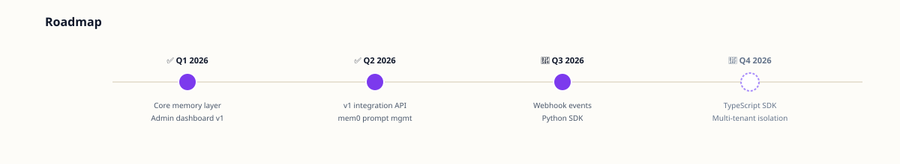

A living document — [docs/ROADMAP.md](docs/ROADMAP.md). Vote on issues and we'll prioritise.

### Community

[](../../discussions)
[](../../issues)
[](CONTRIBUTING.md)
[](.github/CODE_OF_CONDUCT.md)
[](.github/SECURITY.md)

Good first issues: [open issues labelled
`good first issue`](../../issues?q=is%3Aopen+is%3Aissue+label%3A%22good+first+issue%22).
PRs welcome for bug fixes, new backends, console improvements, and docs.

### License

[Apache 2.0](LICENSE). Use it, modify it, ship it commercially — keep the copyright notice and
disclaimer.

### Acknowledgments

Built on **[Mem0](https://github.com/mem0ai/mem0)** (the long-term engine),
**[Milvus](https://milvus.io/)** (vector store for L3), **[PostgreSQL](https://www.postgresql.org/)**
(durable substrate for L1/L2), **[FastAPI](https://fastapi.tiangolo.com)**,
**[TanStack](https://tanstack.com)** (console), **[Pydantic](https://docs.pydantic.dev/)**, and
the open-source AI memory community.

---

<div align="center">

**If Thinkback is useful to you, consider giving it a ⭐ on GitHub — it helps others find it.**

[](https://star-history.com/#mcgrapeng/Thinkback&Date)

<a href="https://github.com/mcgrapeng/thinkback/graphs/contributors">
  
</a>

Built for teams who need memory to be a **service**, not a side project.

</div>