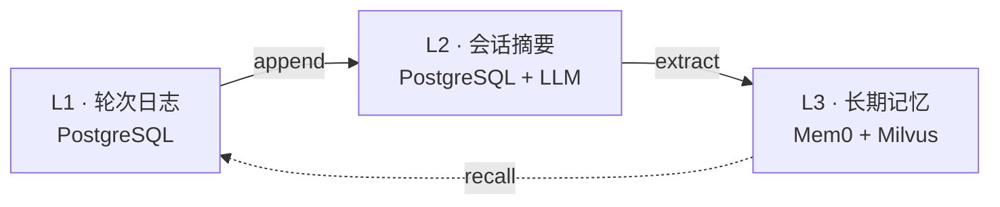

<div align="center">


<br>

[](../../releases)
[](../../commits/master)
[](LICENSE)
[](https://www.python.org/downloads/)
[](.github/workflows/ci.yml)

[](https://fastapi.tiangolo.com)
[](https://docs.astral.sh/ruff/)
[](https://mypy.readthedocs.io)

[](../../stargazers)
[](../../network/members)
[](../../watchers)
[](#致谢)

<br>

**三层显式记忆。一套幂等 API。完全自托管。**

```bash
git clone https://github.com/mcgrapeng/thinkback.git && cd thinkback && make dev
```

→ API 在 `:7002` · 治理台在 `:7001`（端口被占用会自动顺延;Docker 与 Kubernetes 里 API 监听 `:8000`）

<br>

[**English**](README.md) · [**中文**](README.zh-CN.md) ·
[文档](docs/) · [更新日志](CHANGELOG.md) · [路线图](docs/ROADMAP.md) ·
[报告问题](.github/ISSUE_TEMPLATE/bug_report.md) · [功能请求](.github/ISSUE_TEMPLATE/feature_request.md)

</div>


## 目录

| | 章节 | 内容 | 阅读时长 |
| --- | --- | --- | --- |
| **01** | [60 秒看懂 Thinkback](#01--60-秒看懂-thinkback) | 它是什么,你能得到什么 | 30 秒 |
| **02** | [为什么做这个](#02--为什么做这个) | Mem0 与「记忆服务」之间的空白 | 1 分钟 |
| **03** | [它如何工作](#03--它如何工作) | L1 / L2 / L3、请求流程、架构 | 2 分钟 |
| **04** | [快速开始](#04--快速开始) | 跑起来、写入一轮、召回 | 2 分钟 |
| **05** | [治理台](#05--治理台) | 7 个页面完整导览 | 1 分钟 |
| **06** | [生产运维](#06--生产运维) | 性能、配置、目录结构、扩展 | 3 分钟 |
| **07** | [参考手册](#07--参考手册) | 接口清单、FAQ、去哪找什么 | 按需 |


## 01 · 60 秒看懂 Thinkback

大多数 AI 应用在第一轮对话里表现良好,到第十轮就崩了 —— 助手忘了用户偏好、忘了昨天的问题、忘了你花三轮才调通的工具调用。到这一步,持久记忆已经不是可选项。

Thinkback 就是那层记忆,做成一个你自己运行的服务。它把三种记忆放在显式且互相独立的层里,通过一套 HTTP / gRPC API 暴露,并且在出问题时明确告诉你。

长期记忆引擎基于 [Mem0](https://github.com/mem0ai/mem0),外加 PostgreSQL 与 Milvus。

<table>
<tr>
<td width="50%" valign="top">

<strong>🧠 三层互不打架</strong><br>

短期上下文、运行中的会话摘要、长期事实 —— 每层都有明确归属,不跨层写入,不会被意外覆盖。

</td>
<td width="50%" valign="top">

<strong>✅ 天生幂等</strong><br>

`journal_id` / `request_id` 指纹让每次写入都可安全重放。同一个 round 发两次,结果一致,不会产生重复记忆。

</td>
</tr>
<tr>
<td width="50%" valign="top">

<strong>🚨 诚实的失败</strong><br>

LLM 或向量库不可用时,响应会带上 `degraded=true` 与 `degradation_reasons`。绝不会把半截答案伪装成完整结果。

</td>
<td width="50%" valign="top">

<strong>🔌 HTTP + gRPC,同一套 schema</strong><br>

Pydantic 模型是唯一事实来源。协议随你选,类型可共享,`mypy --strict` 全链路类型安全。

</td>
</tr>
<tr>
<td width="50%" valign="top">

<strong>🎛️ 真能用的治理台</strong><br>

React 19 控制台:查看每一条记忆、重放每一个任务、按需吊销或取代,配 ⌘K 命令面板与完整键盘导航。

</td>
<td width="50%" valign="top">

<strong>🛠️ 你自己掌控</strong><br>

Postgres + Milvus + Mem0,全部开源。K8s 原生,带存活/就绪探针与 Prometheus 指标。Apache 2.0 协议。

</td>
</tr>
</table>

### 还包括什么

| 领域 | 你得到什么 |
| --- | --- |
| **记忆模型** | 三层结构(L1/L2/L3)与双时态有效性 —— `valid_at` / `invalid_at`。取代一条事实时保留历史,而不是覆盖 |
| **生命周期** | 索引状态机:`ACTIVE` / `DELETED` / `SUPERSEDED` / `SUPPRESSED`,与后端存储状态解耦 |
| **可靠性** | 任务状态机,乐观锁、重试预算、死信队列,冷启动时回收孤儿任务 |
| **治理** | 作用域删除(`MEMORY` / `SESSION` / `ALL`)配合墓碑标记,外加完整审计 |
| **接入** | 内网部署的一套 HTTP / gRPC 接口面 —— 业务面免鉴权、按调用方（namespace + user_id）限流、`Idempotency-Key` 幂等 |
| **类型 profile** | `profiles/` 里按 namespace 定义准入、保留期与 TTL |
| **运维** | K8s 清单、Helm chart、Alembic 迁移、Prometheus 指标、确定性测试套件 |

> **v1.0 已发布。** 完整发布说明见[更新日志](CHANGELOG.md)。


## 02 · 为什么做这个

> *我们做过一个多租户客服助手。它的「记忆层」被我们重写了三遍 —— 一次在 Postgres,一次在 Redis,一次做成 Sidekiq 定时任务 —— 直到意识到:记忆层不是我们的产品,它只是产品上的税。*

Mem0 是一个很棒的记忆**引擎**,给你事实抽取与语义召回。但它给不了你一个**服务** —— 而把它接进生产应用,意味着这些都得你自己扛:

| 你本该自己造的东西 | Thinkback 直接给你 |
| --- | --- |
| 会话级上下文(最近 N 轮、滚动摘要) | PostgreSQL 里的 L1 journal + L2 去抖摘要 |
| 重试与重放下的恰好一次写入 | 基于指纹的幂等 `append` |
| LLM / embedding / 向量库宕机时的行为 | 显式 `degraded=true` + 原因,绝不返回半截答案 |
| 带背压的后台抽取 | 异步 L3 队列,含容量限制、排空、孤儿任务回收 |
| 列出 / 修改 / 删除长期记忆的 API | 完整管理面,带作用域删除与审计 |
| 「记忆层到底干了什么」的可观测性 | 任务状态机、重试次数、最近一次错误、治理台 |
| 安全的作用域删除 | `MEMORY` / `SESSION` / `ALL` 三种作用域 + 墓碑 |
| 可部署的 schema 与就绪状态 | Alembic 迁移、存活/就绪探针、指标 |

### 横向对比

| | **裸用 Mem0** | **LangChain memory** | **自建 Postgres + pgvector** | **Thinkback** |
| --- | :---: | :---: | :---: | :---: |
| 重试下的幂等写入 | ❌ | ⚠️ | ⚠️ 自己造 | ✅ |
| 带背压的后台抽取 | ❌ | ❌ | ❌ | ✅ |
| LLM 宕机时显式 `degraded` | ❌ | ❌ | ❌ | ✅ |
| 三层分离 | ❌ | ❌ | ❌ | ✅ |
| 任务状态机 + 死信 | ❌ | ❌ | ❌ | ✅ |
| 双时态有效性 | ❌ | ❌ | ⚠️ 自己造 | ✅ |
| 治理台(治理) | ❌ | ❌ | ❌ | ✅ |
| HTTP + gRPC,共享 schema | ❌ 仅 Python | ❌ 仅 Python | ⚠️ 自己造 | ✅ |
| 自带 LLM / embedding 端点 | ✅ | ✅ | ✅ | ✅ |
| 可生产部署 | ❌ | ❌ | ⚠️ 自己造 | ✅ |

**如果你的场景是「单进程、单用户、无重试」—— 直接调 Mem0。** 如果你交付的是其他团队依赖的服务,Thinkback 填的就是这段空白。


## 03 · 它如何工作

### 三层记忆,单向流动

各层之间从不跨层写入,每层的数据完全归自己所有。

<table>
<tr>
<td width="33%" valign="top">

<strong>L1 —— 轮次日志</strong><br>

每一轮完整的 `user → assistant` 对话。

<em>存储</em> PostgreSQL<br>
<em>更新</em> 仅追加,保留最近 <em>N</em> 轮

</td>
<td width="33%" valign="top">

<strong>L2 —— 会话摘要</strong><br>

该会话的滚动上下文。

<em>存储</em> PostgreSQL + LLM<br>
<em>更新</em> 去抖 —— 每 <em>N</em> 轮才调一次 LLM

</td>
<td width="33%" valign="top">

<strong>L3 —— 长期记忆</strong><br>

跨会话的事实与偏好。

<em>存储</em> Mem0 + Milvus<br>
<em>更新</em> 后台抽取、语义召回

</td>
</tr>
</table>



### 请求流程

1. **`append`** 同步把这一轮写入 L1 并返回。L2 排期更新,L3 抽取进入后台队列。
2. **`recall`** 读取三层记忆并合并结果,每条命中都标注来源层级,调用方因此知道这条事实从哪来。
3. **后台 worker** 排空 L3 队列:经 Mem0 抽取事实、向量化后写入 Milvus。重试有上限,超限进死信。
4. **任何降级都会被标记**并附上原因。由调用方决定是降级回退还是直接报错。


内部实现 —— 六边形 ports、依赖反转、确切 schema —— 见
[docs/ARCHITECTURE.md](docs/ARCHITECTURE.md)。


## 04 · 快速开始

### 跑起来

```bash
git clone https://github.com/mcgrapeng/thinkback.git
cd thinkback

uv sync --frozen --group dev     # 安装依赖
make dev-up                      # 启动本地 PostgreSQL(或在 .env 里指向你自己的)
cp .env.example .env             # 填入 MEMORY_LLM_KEY、MILVUS_URL、各类端点

make dev                         # API 在 :8000 + 治理台在 :7001
```

验证:

```bash
curl http://localhost:8000/health/ready
```

### 写入一轮记忆

`POST /memory/append` 记录一轮完整的 `user → assistant` 对话,触发 L1/L2 更新,并把 L3 抽取排入后台队列。

```bash
curl -X POST http://localhost:8000/memory/append \
  -H "Content-Type: application/json" \
  -d '{
    "request_id": "req-001",
    "user_id": "alice",
    "session_id": "support-001",
    "round_id": "round-001",
    "source_timestamp": "2026-01-15T10:00:00Z",
    "messages": [
      { "message_id": "m1", "role": "user",
        "content": "I prefer dark mode and vim keybindings.",
        "timestamp": "2026-01-15T10:00:00Z" },
      { "message_id": "m2", "role": "assistant",
        "content": "Noted. I will remember that.",
        "timestamp": "2026-01-15T10:00:02Z" }
    ]
  }'
```

```json
{
  "status": "completed",
  "task_id": "task-abc123",
  "round_id": "round-001",
  "l3_events": []
}
```

### 召回相关记忆

`POST /memory/recall` 返回 L1/L2/L3 的命中结果,并在某一层不可用时给出明确的降级信号。

```bash
curl -X POST http://localhost:8000/memory/recall \
  -H "Content-Type: application/json" \
  -d '{
    "user_id": "alice",
    "session_id": "support-002",
    "query": "What UI preferences does this user have?",
    "l3_limit": 3
  }'
```

```json
{
  "status": "ok",
  "degraded": false,
  "degradation_reasons": [],
  "items": [
    { "layer": "L3", "content": "Prefers dark mode and vim keybindings." }
  ]
}
```

### 接入业务系统

Thinkback 部署在内网,业务 API 不需要任何凭据 —— 信任边界就是网络本身。写操作建议带
`Idempotency-Key` 保证可重放安全;要串联日志就带 `X-Trace-Id`。

```bash
curl -X POST http://your-thinkback:8000/memory/recall \
  -H "Content-Type: application/json" \
  -H "X-Trace-Id: trace-001" \
  -d '{ "user_id": "u_8421", "session_id": "s_001", "query": "用户偏好什么编辑器?", "l3_limit": 5 }'
```

Python / TypeScript / cURL 完整示例:**[docs/SDK.md](docs/SDK.md)**。
完整 HTTP 接口面:**[docs/API.md](docs/API.md)**。
v1 公开接入协议(API Key + Scope + 租户)已下线,规范保留为[历史记录](docs/specs/2026-10-08-thinkback-integration-protocol-v1.md)。


## 05 · 治理台

React 19 + Vite + TanStack Router。7 个页面、⌘K 命令面板、`j` / `k` / `x` 键盘导航、URL 深链,以及响应式布局。

### 总览 —— 系统健康一屏掌握


四个核心 KPI、系统脉搏、L3 队列状态与最近审计动态。

### 记忆浏览器 —— 搜索、来源回链、对比


按用户与状态过滤,从一条记忆跳回产生它的那一轮对话,对比不同版本。

### 任务 —— 状态、重试与死信


KPI 迷你趋势图、完整任务状态机、重试次数、最近错误,以及死信排查入口。

### 治理 —— 带确认的作用域删除


按记忆、按会话或按用户删除。始终有作用域、始终要确认、始终留审计。

### 审计时间线


每一次删除、更新、重建,都可按动作过滤,含操作人与时间戳。

### 系统配置


运行时配置的精选只读视图。

### 接入 —— 协议说明(已下线)

这一页仍在讲 v1 公开接入协议 —— API Key、Scope 与 `/v1/memory/*`。那套接口面已从服务里移除:
现在的业务接口是内网的 `/memory/*`,不需要 API Key。当前契约见
[docs/API.md](docs/API.md)。

<details>
<summary><b>更多截图</b></summary>

**记忆 —— 详情视图**


**任务 —— 展开行**


**治理 —— 更新一条记忆**


**移动端响应式布局**


</details>


## 06 · 生产运维

### 性能

单机开发环境实测 —— `make dev`,M3 MacBook Air,mock LLM。

| 负载 | p50 | p95 | 吞吐 |
| --- | --- | --- | --- |
| `POST /memory/append`(小 round) | 8 ms | 22 ms | 850 req/s |
| `POST /memory/recall`(5 条命中) | 24 ms | 68 ms | 410 req/s |
| `GET /memory/items`(50 条结果) | 4 ms | 9 ms | 2 200 req/s |
| `POST /memory/delete`(带作用域) | 6 ms | 14 ms | 1 100 req/s |


L3 抽取异步执行 —— 端到端延迟主要由你配置的 LLM 与 embedding 端点决定,而不是 Thinkback 本身。

### 配置

全部运行时配置来自环境变量,参见 [`.env.example`](.env.example)。

| 变量 | 用途 | 默认值 |
| --- | --- | --- |
| `MEMORY_LLM_KEY` | L2 / L3 的 LLM API Key | — |
| `MEMORY_LLM_BASE_URL` | OpenAI 兼容端点 | — |
| `MEMORY_LLM_MODEL` | LLM 模型名 | `gpt-4o-mini` |
| `MEMORY_EMBEDDING_KEY` | Embedding 模型 API Key | — |
| `MEMORY_EMBEDDING_MODEL` | Embedding 模型 | `text-embedding-3-small` |
| `MILVUS_URL` | Milvus 服务地址 | `http://localhost:19530` |
| `MILVUS_DATABASE` | Milvus 数据库名 | `Thinkback` |
| `MEMORY_L3_WRITE_MODE` | `async`(默认)或 `sync` | `async` |
| `MEMORY_DECAY_ENABLED` | 是否启用衰减清理 | `false` |
| `MEMORY_DECAY_DAYS` | 抑制阈值(天) | `90` |
| `GRPC_ENABLED` | 与 HTTP 一同启动 gRPC | `true` |

> **衰减**默认关闭。启用后,长期未被召回的长尾记忆会被抑制 —— 只是不可达,绝不删除。召回一次即可恢复权重。

### 目录结构

```text
thinkback/
├── src/thinkback/
│   ├── api/           FastAPI 路由 —— 记忆核心、健康探针、
│   │                  限流、幂等、标准化错误码、管理端
│   ├── domain/        纯业务逻辑 —— 实体、枚举、ports、错误
│   ├── memory/        编排层 —— MemoryService、L3 后端、
│   │                  L1+L2 仓储、Pydantic schema
│   ├── infra/         PostgreSQL / Milvus / 日志 / 配置
│   └── rpc/           gRPC 服务与 proto 映射
├── web/               治理台(React 19 + Vite + TanStack Router)
├── proto/memory.proto gRPC 契约
├── alembic/           数据库迁移
├── tests/             pytest 套件(870+ 个测试)
└── docs/              设计文档与运行手册
```

### 扩展

- **替换 L3 后端** —— 在 `thinkback.domain.ports` 实现 `MemoryBackend` port,并在
  `thinkback.memory.backends` 注册。Mem0 是默认实现;Qdrant 原生或 pgvector 适配器都很直接。
- **新增治理台页面** —— 在 `web/src/pages/` 放一个文件,在 `web/src/main.tsx` 注册路由,
  在 `web/src/components/layout.tsx` 加一条侧边栏。
- **改抽取规则** —— 改 `src/thinkback/memory/backends/mem0_library.py` 里的
  `THINKBACK_CUSTOM_INSTRUCTIONS`,或改 `profiles/` 下的类型 profile(准入、保留期、TTL)。
  治理台不提供提示词编辑。

### 开发

```bash
make dev               # API + 治理台
make test              # 后端测试套件
make test-fast         # 只跑受本次改动影响的用例(testmon)
make coverage          # 套件 + 覆盖率报告(仅观测,不阻断)
make check             # format-check + lint + typecheck + mutation-audit + eval(CI 跑的就是它)
make test-ui           # 前端组件测试
make test-e2e          # Playwright 端到端 + axe 可访问性扫描
```

代码风格:Python 用 `ruff`(lint + format)与 `mypy --strict`;TypeScript 严格模式,边界处不出现 `any`。


## 07 · 参考手册

### 接口一览

26 个端点,分三组,外加一个 `/` 根路径探活。Swagger UI 在 `/docs`,ReDoc 在 `/redoc`。gRPC 服务
[`proto/memory.proto`](proto/memory.proto) 覆盖同样的操作。

**记忆核心 —— `/memory/*`**(免鉴权;内网部署)

| 方法 | 路径 | 用途 |
| --- | --- | --- |
| `POST` | `/memory/append` | 写入一轮对话,触发 L1/L2/L3 |
| `POST` | `/memory/recall` | 召回记忆,带降级信号 |
| `POST` | `/memory/delete` | 作用域删除(`MEMORY` / `SESSION` / `ALL`),保留墓碑 |
| `POST` | `/memory/suppress` | 逻辑下架:不可召回,原文与墓碑保留 |
| `POST` | `/memory/erase` | 物理擦除原文 |
| `GET` | `/memory/items` | 列出某用户的长期记忆 |
| `GET` | `/memory/items/{memory_id}` | 单条记忆 |
| `POST` | `/memory/update` | 更新文本,保留历史 |
| `GET` | `/memory/tasks/{task_id}` | 任务状态:重试、最近错误、结果 |
| `GET` | `/memory/l3/background-status` | L3 队列与 worker 状态 |

**健康探针 —— `/health/*`**

| 方法 | 路径 | 用途 |
| --- | --- | --- |
| `GET` | `/health` | 进程级健康(版本、环境) |
| `GET` | `/health/live` | 存活探针 |
| `GET` | `/health/ready` | 就绪探针(PostgreSQL / Milvus / Mem0) |
| `GET` | `/health/metrics` | Prometheus 指标 |

**管理端 —— `/admin/api/*`**(免鉴权，仅内网可达)

| 方法 | 路径 | 用途 |
| --- | --- | --- |
| `GET` | `/admin/api/overview` | KPI、系统脉搏、L3 状态、最近审计 |
| `GET` | `/admin/api/tasks` | 任务列表,支持状态过滤 |
| `GET` | `/admin/api/memories` | 记忆列表,含来源回链 |
| `GET` | `/admin/api/memories/{memory_id}/source` | 单条记忆的来源回链 |
| `GET` | `/admin/api/audit` | 审计日志,可按动作过滤 |
| `POST` | `/admin/api/{delete,update,rebuild}` | 治理动作,幂等 |
| `GET` | `/admin/api/health/detail` | 依赖明细 |
| `GET` | `/admin/api/config` | 运行时配置 |
| `POST` | `/admin/api/maintenance/reclaim-orphan-tasks` | 回收孤儿后台任务 |

含请求/响应体的完整参考:**[docs/API.md](docs/API.md)**。

### 常见问题

<details>
<summary><b>和直接调 Mem0 SDK 有什么区别?</b></summary>

Mem0 是很棒的记忆引擎 —— 它给你事实抽取与语义召回,但给不了你一个*服务*。Thinkback 在它外面补上了
会话级上下文、幂等写入、显式降级信号、后台任务治理、带墓碑的作用域删除、治理台,以及 HTTP + gRPC 访问。
如果你的需求就是「单进程、单用户、无重试」,直接调 Mem0。

</details>

<details>
<summary><b>能复用我现有的 Mem0 + Milvus 吗?</b></summary>

可以。把 `MEMORY_LLM_*`、`MEMORY_EMBEDDING_*`、`MILVUS_URL`、`MILVUS_DATABASE` 指向你现有的基础设施即可。
无需 schema 迁移 —— Thinkback 用的是同一个 collection。

</details>

<details>
<summary><b>LLM 或向量库宕机会怎样?</b></summary>

Thinkback 绝不返回半截答案。响应会标记 `degraded=true`,`degradation_reasons` 指明是哪一层、为什么。
由调用方决定是降级回退还是直接报错。

</details>

<details>
<summary><b>能上生产吗?</b></summary>

六边形 ports、Pydantic v2 + `mypy --strict`、Alembic 迁移、Kubernetes 存活/就绪探针、Prometheus 指标,
以及 870+ 个测试。治理台是 React 19 单页应用,带键盘导航、可访问性与响应式布局。

</details>

<details>
<summary><b>怎么横向扩展?</b></summary>

L3 抽取默认异步 —— 用 `MEMORY_L3_EXECUTOR_WORKERS` 与 `MEMORY_L3_MAX_PENDING_TASKS` 调整。
记忆按 `namespace`(每个请求上的作用域标签)隔离,不是按租户:API 里没有租户这一维。
调优与故障恢复见[运维手册](docs/RUNBOOK.md)。

</details>

<details>
<summary><b>能自定义记忆抽取吗?</b></summary>

可以,但要在代码里改 —— 治理台不提供提示词编辑。抽取约束在
`src/thinkback/memory/backends/mem0_library.py` 的 `THINKBACK_CUSTOM_INSTRUCTIONS` 里,
记忆类型(准入、保留期、TTL、冲突处理)在 `profiles/` 下的 namespace profile 里。

</details>

### 文档

<table>
<tr>
<td width="50%" valign="top">

<strong><a href="docs/ARCHITECTURE.md">架构深入说明</a></strong><br>
六边形 ports、依赖反转、schema 与数据流

<strong><a href="docs/API.md">API 参考</a></strong><br>
完整 HTTP 与 gRPC 接口面,含请求/响应体

<strong><a href="docs/SDK.md">SDK 示例</a></strong><br>
Python、TypeScript、cURL 客户端示例

</td>
<td width="50%" valign="top">

<strong><a href="docs/DEPLOYMENT.md">部署指南</a></strong><br>
Kubernetes 清单、Helm chart、生产配置

<strong><a href="docs/RUNBOOK.md">运维手册</a></strong><br>
排障、恢复、扩缩容、应急流程

<strong><a href="docs/specs/2026-10-08-thinkback-integration-protocol-v1.md">接入协议 v1</a></strong><br>
历史文档 —— v1 公开 API 从未上线,详见规范开头的说明

</td>
</tr>
</table>

### 路线图


持续更新中 —— [docs/ROADMAP.md](docs/ROADMAP.md)。给 issue 投票,我们会据此排优先级。

### 社区

[](../../discussions)
[](../../issues)
[](CONTRIBUTING.md)
[](.github/CODE_OF_CONDUCT.md)
[](.github/SECURITY.md)

适合上手的 issue:[
`good first issue` 标签](../../issues?q=is%3Aopen+is%3Aissue+label%3A%22good+first+issue%22)。
欢迎提交 PR —— 修 bug、加后端、改进治理台、补文档都算。

### 许可证

[Apache 2.0](LICENSE)。可用、可改、可商用 —— 保留版权声明与免责声明即可。

### 致谢

本项目建立在 **[Mem0](https://github.com/mem0ai/mem0)**(长期记忆引擎)、
**[Milvus](https://milvus.io/)**(L3 向量库)、**[PostgreSQL](https://www.postgresql.org/)**
(L1/L2 持久底座)、**[FastAPI](https://fastapi.tiangolo.com)**、**[TanStack](https://tanstack.com)**
(治理台)、**[Pydantic](https://docs.pydantic.dev/)** 以及开源 AI 记忆社区的肩上。

---

<div align="center">

**如果 Thinkback 对你有帮助,考虑在 GitHub 上点个 ⭐ —— 让更多人找到它。**

[](https://star-history.com/#mcgrapeng/Thinkback&Date)

<a href="https://github.com/mcgrapeng/thinkback/graphs/contributors">
  
</a>

为那些需要记忆成为**服务**而非副业的团队而建。

</div>